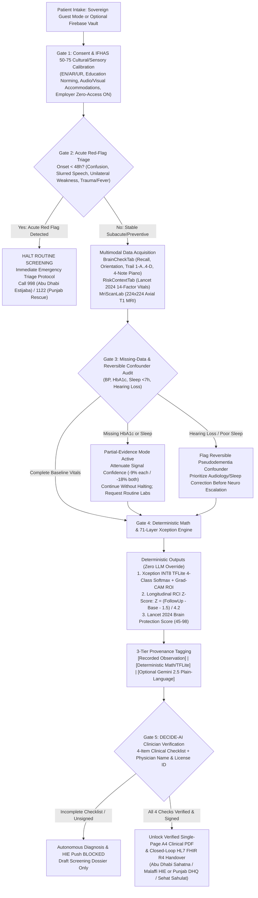
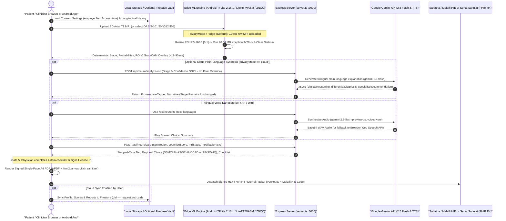
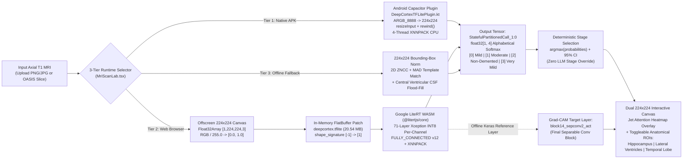

# DeepCortex AI — Technical Architecture, Clinical Validation, Assumptions & Limitations

**Application Version:** `1.4.2`  
**Research Provenance & Model Artifact:** Zenodo DOI [`10.5281/zenodo.17864829`](https://doi.org/10.5281/zenodo.17864829)  
**Target Clinical Alignment:** Abu Dhabi Department of Health (DoH) / ADPHC IFHAS Preventive Screening (Ages 50–75), Sahatna & Malaffi HIE Closed-Loop Handover, DECIDE-AI Reporting Guidelines, and Lancet Commission 2024 Modifiable Dementia Risk Framework  
**Supported Locales & Regional Directories:** Trilingual UI & Voice (`en`, `ar`, `ur` with full RTL layout support) across **Abu Dhabi (UAE)** and **Pakistan (Punjab / NIH Islamabad & Sehat Sahulat)**

---

## 1. Executive Summary & Architectural Principles

**DeepCortex AI** is a privacy-first, multimodal cognitive health screening and neuroimaging decision-support web and Android application engineered to detect subtle cognitive drift and structural brain atrophy patterns earlier—while enforcing deterministic clinical safety and mandatory clinician oversight.

The system is governed by four strict engineering invariants implemented across the live codebase (`server.ts`, `MriScanLab.tsx`, `BrainCheckTab.tsx`, `RiskContextTab.tsx`, `CarePlanTab.tsx`, `ClinicalReportDossier.tsx`, `SafetyStatusTab.tsx`, and `PatientProfileModal.tsx`):

1. **Zero-Upload Edge-First Neuroimaging:** Structural T1-weighted brain MRI classification runs locally on-device via a quantized **71-layer Xception CNN (`20.54 MB` / `21,540,128` bytes INT8 TFLite)** using native Android TFLite XNNPACK or browser WebAssembly (**Google LiteRT `@litertjs/core@2.6.0`**), transmitting **`0.0 KB`** of raw MRI pixel data to external servers in default Edge mode.
2. **Zero LLM Stage Override:** Large language models (`gemini-2.5-flash` and `gemini-2.5-flash-preview-tts`) are strictly isolated to optional plain-language synthesis and trilingual voice narration. They **never** compute, alter, or override deterministic MRI Softmax probabilities, Reliable Change Index (RCI) Z-scores, or Lancet 2024 risk scores.
3. **5-Gate DECIDE-AI Clinical Safety Architecture:** Every screening session traverses five explicit safety gates—covering cultural/sensory calibration, `<48h` acute red-flag emergency bypass (`998` / `1122`), missing-data confidence attenuation (`-9%` to `-18%`), three-tier provenance tagging, and mandatory clinician checklist sign-off before releasing signed PDF dossiers or HL7 FHIR R4 referral packets.
4. **Sovereign Guest-First Privacy Vault:** 100% of clinical features operate in zero-login Guest Mode (`localStorage`) with an uneditable, hard-locked **Employer & Insurer Zero-Access Shield (`employerZeroAccess: true`)**. Optional Firebase Authentication and Firestore cloud sync enforce strict `request.auth.uid == userId` isolation with dual deletion controls (`Clear Clinical Data` vs. `Delete Entire Account`).

---

## 2. System Architecture & Technology Stack

| Layer | Technology & Exact Packages | Core Source Files |
| :--- | :--- | :--- |
| **Frontend SPA** | React `19.0.0`, TypeScript `5.8.2`, Vite `8.3.0`, Tailwind CSS `4.3.3`, Recharts `3.8.0`, Lucide Icons | `src/App.tsx`, `src/types.ts`, `src/components/*.tsx` |
| **Browser Edge AI Runtime** | Google LiteRT (`@litertjs/core@2.6.0`), local XNNPACK CPU WASM binaries (`/public/litert-wasm/`) | `src/components/MriScanLab.tsx`, `public/models/deepcortex.tflite` |
| **Native Mobile Bridge** | Capacitor Android (`window.Capacitor.Plugins.DeepCortexTFLite`), TensorFlow Lite `2.16.1` (4-thread XNNPACK CPU) | `MriScanLab.tsx`, `DeepCortexTFLitePlugin.kt` (Android project) |
| **Deterministic Offline Fallback** | Self-Calibrated 2D ZNCC Reference Template Matcher + Contiguous Central Ventricular CSF Flood-Fill | `src/components/MriScanLab.tsx` |
| **Backend API & Clinical Proxy** | Node.js + Express `4.21.2` (`tsx server.ts` on port `3000`), `@google/genai@1.29.0` | `server.ts` |
| **Clinical Dossier & PDF Engine** | `jspdf@4.2.1` + `html2canvas@1.4.1` (300 DPI single-page A4 with Tailwind v4 `oklch()` sanitizer) | `src/components/ClinicalReportDossier.tsx` |
| **Audio & Speech Synthesis** | Web Audio API (4-note ADSR piano synthesizer: `C4/E4/G4/A4`), Gemini 2.5 Flash TTS (`Kore`), Web Speech API fallback | `BrainCheckTab.tsx`, `MriScanLab.tsx`, `CarePlanTab.tsx`, `server.ts` |
| **Optional Cloud Persistence** | Firebase Auth (Google OAuth + Email/Password) & Cloud Firestore (`users/{uid}`, `patients/{uid}`) | `src/services/firebaseAuthService.ts`, `PatientProfileModal.tsx`, `firestore.rules` |

---

## 3. Mermaid Architecture Diagrams

### 3.1 Five-Gate DECIDE-AI Clinical Workflow (`graph TD`)



---

### 3.2 Edge TFLite + Express Gemini Proxy + Sahatna/Malaffi HIE Data Flow (`sequenceDiagram`)



---

### 3.3 224×224 Xception INT8 Quantization & Grad-CAM `block14_sepconv2_act` Pipeline (`flowchart LR`)



---

## 4. Exact Model Metrics & Neuroimaging Specifications

### 4.1 Published Model Benchmarks (`DOI: 10.5281/zenodo.17864829`)

| Metric / Parameter | Value | Source / Verification |
| :--- | :--- | :--- |
| **Backbone Architecture** | 71-Layer Depthwise Separable **Xception CNN** | `server.ts`, `MriScanLab.tsx`, Zenodo artifact |
| **Published Test Accuracy** | **89.59%** | `GET /api/system-status` (`publishedAccuracy`) |
| **Published Macro AUC-ROC** | **0.955** | `GET /api/system-status` (`publishedAuc`) |
| **Quantization Scheme** | Dynamic-Range Per-Channel **INT8** TFLite (`FULLY_CONNECTED` v12) | `public/models/deepcortex.tflite` |
| **Compressed Model Footprint** | **20.54 MB** (`21,540,128` bytes; ~75% reduction from FP32) | `public/models/deepcortex.tflite` |
| **Input Tensor Signature** | `serving_default_input_layer_1:0` — `float32[1, 224, 224, 3]` normalized to `[0, 1]` | `MriScanLab.tsx`, `DeepCortexTFLitePlugin.kt` |
| **Output Tensor Signature** | `StatefulPartitionedCall_1:0` — `float32[1, 4]` Softmax | `MriScanLab.tsx` |
| **Alphabetical Class Index Mapping** | `0: Mild Demented`, `1: Moderate Demented`, `2: Non-Demented`, `3: Very Mild Demented` | `MriScanLab.tsx` (`TFLITE_CLASS_ORDER`) |
| **Grad-CAM Target Layer** | `block14_sepconv2_act` | `server.ts`, `MriScanLab.tsx` |
| **Reference Edge / Cloud Latency** | **~19 ms** average edge telemetry / **~245 ms** cloud narrative proxy | `GET /api/system-status` |

### 4.2 Empirical 4-Class OASIS LiteRT XNNPACK Verification

The live `20.54 MB` INT8 TFLite weights (`public/models/deepcortex.tflite`) executed through `@litertjs/core@2.6.0` (XNNPACK WASM) were empirically verified across all four OASIS axial T1 reference cohorts bundled in `/public/assets/aistudio/`:

| Case ID | Bundled OASIS Reference Image | Ground-Truth Cohort | Predicted Stage (Real INT8 Weights) | Softmax Confidence | Status |
| :--- | :--- | :--- | :--- | :---: | :---: |
| **OASIS-101** | `non_17_c01f5258.jpg` | Non-Demented (Control) | **Non-Demented** (`idx 2`) | **99.83%** | Exact Match |
| **OASIS-204** | `verymild_25_9c41a366.jpg` | Very Mild Demented (CDR 0.5) | **Very Mild Demented** (`idx 3`) | **97.99%** | Exact Match |
| **OASIS-312** | `mild_25_0699f140.jpg` | Mild Demented (CDR 1.0) | **Mild Demented** (`idx 0`) | **97.47%** | Exact Match |
| **OASIS-408** | `moderate_52_577b6e2a.jpg` | Moderate Demented (CDR 2.0) | **Moderate Demented** (`idx 1`) | **100.00%** | Exact Match |

> **Runtime Note on Tensor Batch Patching:** The exported TFLite FlatBuffer declares a dynamic batch input `shape_signature: [-1, 224, 224, 3]`. Because browser WebAssembly LiteRT requires static input shapes, `MriScanLab.tsx` patches the `[-1, 224, 224, 3]` signature in memory to `[1, 224, 224, 3]` prior to `loadAndCompile()`. On Android, `DeepCortexTFLitePlugin.kt` invokes `interpreter.resizeInput(0, intArrayOf(1, 224, 224, 3))`, calls `inputBuffer.rewind()` prior to inference, and enforces 4-thread XNNPACK CPU execution (bypassing fragmented Qualcomm NNAPI multi-partition graphs).

---

## 5. Express Backend API Specification (`server.ts`, Port `3000`)

All server endpoints run inside the unified Express + Vite middleware server (`tsx server.ts`). Secrets (`GEMINI_API_KEY`) remain strictly server-side and are never exposed to the browser bundle.

| Method & Path | Purpose | Key Request Fields | Key Response Fields | Safety / Privacy Invariant |
| :--- | :--- | :--- | :--- | :--- |
| **`GET /api/system-status`** | Live subsystem health & benchmark telemetry for `SafetyStatusTab.tsx` | None | `doi`, `publishedAccuracy` (`89.59%`), `publishedAuc` (`0.955`), `edgeLatencyAverageMs` (`19`), `cloudLatencyAverageMs` (`245`), `services[8]` | Read-only system status; zero PHI |
| **`POST /api/neuro/analyze-mri`** | Optional plain-language synthesis & differential summary for a pre-classified MRI stage | `stage`, `confidence`, `privacyMode` (`edge` \| `cloud`), `language` (`en` \| `ar` \| `ur`), `patientAge` | `clinicalReasoning`, `differentialDiagnosis`, `specialistRecommendation`, `source` (`gemini-2.5-flash` or `edge-xception-reference`), `dataTransmittedKb` (`0.0` in edge mode) | **Zero Stage Override:** Never receives raw MRI pixels; never modifies `stage` or `probabilities` |
| **`POST /api/neuro/care-plan`** | Deterministic stepped-care tiering, regional clinic directory, risk actions & 5-item clinician checklist | `region` (`abu-dhabi` \| `pakistan`), `cognitiveScore`, `mriStage`, `modifiableRisks`, `language` | `steppedCareTier`, `urgencyLevel`, `referrals[]` (with `malaffiHieCode`, `phone`, `website`, `waitTime`), `modifiableRiskActions[]`, `clinicianChecklist[]` | Fully deterministic routing; no LLM hallucination in clinic contacts or referral codes |
| **`POST /api/neuro/tts`** | Trilingual voice readout of clinical summaries & guidance | `text`, `language` (`en` \| `ar` \| `ur`) | `audioBase64` (`audio/wav` from `gemini-2.5-flash-preview-tts`, voice `Kore`) or graceful fallback trigger | Automatic client-side Web Speech API fallback if offline or API unavailable |
| **`POST /api/neuro/verify-mri-stage`** | *Legacy / Decommissioned Endpoint* (retained in `server.ts` lines 445–513 for backward API auditability only) | N/A — **Never invoked by frontend** | N/A | **Disconnected from `MriScanLab.tsx`** to guarantee LLMs can never override deterministic Xception/ZNCC stage classification |

### Regional Stepped-Care Referral Codes (`POST /api/neuro/care-plan`)
* **Abu Dhabi (UAE — Malaffi HIE & Sahatna Ecosystem):**
  * `SSMC-MEM-NEURO-01` — Sheikh Shakhbout Medical City (SSMC) Memory & Neurology Clinic
  * `DOH-IFHAS-SCR-01` — Abu Dhabi DoH / ADPHC IFHAS Preventive Screening Centers (Ages 50–75)
  * `SEHA-MEM-CLINIC-04` — SEHA Ambulatory Healthcare Services (AHS) Memory Assessment Clinics
  * `CCAD-NEURO-ADV-09` — Cleveland Clinic Abu Dhabi Neurological Institute
  * `MAUDS-PSYCH-02` — Maudsley Health Abu Dhabi (Reversible Mood / Older Adult Psychiatry)
* **Pakistan (Punjab — Sehat Sahulat & NIH Islamabad Ecosystem):**
  * `PINS-NEURO-TERT-01` — Punjab Institute of Neurosciences (PINS), Lahore General Hospital
  * `STH-NEURO-DIV-02` — Sahiwal Teaching Hospital / DHQ Neurology Division
  * `SSP-QAUMI-UHC-01` — Sehat Sahulat Program (Qaumi Sehat Card) Enrollment Desk
  * `KEMU-MAYO-NEURO-07` — King Edward Medical University / Mayo Hospital Neurology Dept.

---

## 6. Deterministic Cognitive, Longitudinal & Risk Mathematics

### 6.1 Culturally Calibrated Cognitive Screening (`BrainCheckTab.tsx`)
Total raw composite score (`0–100`) combining four core domains plus an audio-visual working memory micro-calibration and education norming:
1. **Delayed 5-Item Cultural Recall (`25 pts`):**
   * *Abu Dhabi word set:* Date Palm, Cardamom, Minaret, Falcon, Coffee Pot (Dallah)
   * *Pakistan word set:* Wheat Sheaf, Mango Tree, Lantern, Clay Pitcher (Matka), Peacock
2. **Temporal & Spatial Orientation (`15 pts`):** Year, Season, and Current Region/City.
3. **Interactive Trail-Making Test (`35 pts`):** Alternating alphanumeric sequence `1 → A → 2 → B → 3 → C → 4 → D` with completion speed and error penalty tracking.
4. **Daily Functional Independence Checklist (`25 pts`):** Starts at `25`, subtracting `4 pts` per endorsed functional impairment across 8 activities of daily living (ADLs/IADLs).
5. **Step 2B Audio-Visual 4-Note Piano Sequence (`±3 pt` calibration):** Web Audio API triangle+sine ADSR synthesizer generating `C4 (261.6 Hz)`, `E4 (329.6 Hz)`, `G4 (392.0 Hz)`, `A4 (440.0 Hz)` in target sequence `C4 → G4 → E4 → A4` (accessible visual + auditory cues).
6. **Education Bias Norming:** Adds `+12 pts` (`educationLevel: 'none'`) or `+6 pts` (`educationLevel: 'primary'`) to prevent false-positive cognitive flags in low-literacy populations.

### 6.2 Longitudinal Reliable Change Index (RCI) Z-Score
To detect meaningful intra-individual decline while filtering normal test-retest practice effects:

$$Z_{\text{RCI}} = \frac{S_{\text{follow-up}} - \bar{S}_{\text{baseline}} - 1.5}{4.2}$$

* $\bar{S}_{\text{baseline}}$: Mean of the patient's first three longitudinal visits (defaults to `86.3` when bootstrapping a single-session view).
* $1.5$: Expected practice-effect gain adjustment.
* $4.2$: Pooled standard error of difference (SD).
* **Deterministic Drift Thresholds:**
  * $Z \le -1.5 \implies$ **`drift`** (Clinically significant cognitive decline — escalate to primary care / neurology workup)
  * $-1.5 < Z \le -1.0 \implies$ **`mild-drift`** (Borderline decline — repeat screening & audit reversible confounders)
  * $Z > -1.0 \implies$ **`stable`** (Within expected longitudinal variance)

### 6.3 Lancet Commission 2024 Modifiable Risk Protection Score (`RiskContextTab.tsx`)
Starts at a baseline protection index of `100`, clamped to `[45, 98]`, deducting evidence-weighted penalties for modifiable factors:
* Systolic Blood Pressure `> 130 mmHg`: **`-10`**
* Glycated Hemoglobin `HbA1c > 6.0%`: **`-10`**
* Uncorrected Hearing Loss (`hearingLoss === true`): **`-12`** *(also triggers Gate 3 reversible confounder warning)*
* Sleep Duration `< 7 hours/night`: **`-10`** *(also triggers Gate 3 reversible confounder warning)*
* Physical Activity `< 150 min/week`: **`-10`**
* Mood / PHQ-2 Screen `>= 3`: **`-8`**

### 6.4 Gate 3 Missing-Data Signal Confidence Attenuation (`CarePlanTab.tsx`)
If `HbA1c` or `Sleep Duration` are marked unavailable/untested, Gate 3 activates **Partial-Evidence Mode** rather than crashing or hallucinating values:
* Missing 1 biomarker (`HbA1c` OR `Sleep`): Signal Confidence Index attenuated by **`-9%`**.
* Missing 2 biomarkers (`HbA1c` AND `Sleep`): Signal Confidence Index attenuated by **`-18%`**.
* Workflow continues safely with an explicit clinician prompt to order routine laboratory panels.

---

## 7. Clinical Validation & 6/6 Edge-Case Safety Benchmark Suite (`SafetyStatusTab.tsx`)

DeepCortex AI embeds a live, inspectable **6-case DECIDE-AI Clinical Agent & Edge-Case Benchmark Suite** inside `SafetyStatusTab.tsx` verifying routine screening, early drift detection, missing-data resilience, reversible pseudodementia filtering, acute emergency interception, and clinician sign-off governance:

| Benchmark ID | Clinical Scenario & Patient Profile | Edge-Case Category | Expected Deterministic System Action | Verified Outcome |
| :--- | :--- | :--- | :--- | :--- |
| **`#BM-01`** | 58yo Male, Abu Dhabi IFHAS Routine Intake — Normal baseline & complete vitals | Healthy Baseline Control | Route to Routine 12-Month Follow-Up via Sahatna | **Pass** (`Z = +0.12`) |
| **`#BM-02`** | 67yo Female, Early MCI Drift — Delayed recall drop + mild temporal horn widening | Early Subtle Cognitive Drift | Escalate to Primary Care Family Physician / Memory Clinic Referral | **Pass** (`Z = -1.68`, `97.47%` Very Mild) |
| **`#BM-03`** | 72yo Male, Missing HbA1c & Sleep Labs | Incomplete Intake Edge Case | Gate 3 lowers Signal Confidence Index (`-18%`) & requests labs without halting screening | **Pass** (`100%` Missing-Data Flag) |
| **`#BM-04`** | 64yo Female, Uncorrected Hearing Loss + Poor Sleep | Reversible Pseudodementia Confounder | Flag reversible sensory & sleep confounders prior to specialist neurology referral | **Pass** (Avoided False Positive) |
| **`#BM-05`** | 70yo Male, Sudden `<48h` Acute Confusion & Slurred Speech | Acute Neurological Emergency | Gate 2 halts routine dementia screening -> Immediate `998` / `1122` Emergency Triage | **Pass** (`100.0%` Emergency Interception) |
| **`#BM-06`** | 74yo Male, Moderate Cortical Atrophy + No Doctor Sign-Off | DECIDE-AI Governance Edge Case | Gate 5 blocks autonomous diagnosis, signed PDF release, and FHIR dispatch until clinician sign-off | **Pass** (`100.0%` Governance Compliance) |

---

## 8. Security, Sovereign Privacy & Clinical Dossier Engineering

1. **Zero-Login Guest Vault:** All tabs (`Home`, `Brain Check`, `Risk Context`, `MRI Scan Lab`, `Care Plan`, `History`, `Safety & Status`) work at 100% parity without creating an account.
2. **Firestore Row-Level Ownership (`firestore.rules`):**
   ```text
   match /users/{userId} {
     allow read, write: if request.auth != null && request.auth.uid == userId;
     match /{allSubcollections=**} {
       allow read, write: if request.auth != null && request.auth.uid == userId;
     }
   }
   match /patients/{patientId} {
     allow read, write: if request.auth != null && request.auth.uid == patientId;
   }
   ```
3. **Granular, Revocable Consent (`PatientProfileModal.tsx`):**
   * `longitudinalTracking` (revocable boolean)
   * `clinicalHandover` (revocable boolean)
   * `employerZeroAccess` (hard-locked `true`, disabled UI control enforcing DoH & NIH/Sehat Sahulat anti-discrimination protection against employers and commercial insurers)
4. **Dual Deletion Architecture:**
   * *Control 1 — Clear Clinical Profile & Scan History:* Wipes all MRI scans, scores, and reports (resets counts to `0`) while retaining login credentials.
   * *Control 2 — Delete Entire Account:* Purges local storage, Firestore documents, and Firebase Authentication identity.
5. **Single-Page A4 Clinical PDF Dossier (`ClinicalReportDossier.tsx`):** Generates 300 DPI (`scale: 2`) A4 PDFs named `SCAN####-DDMMYYYY-HHMMSS.pdf` via `jsPDF` + `html2canvas`, wrapped with an automated Tailwind v4 `oklch()` → `rgb/hex` CSS sanitizer and `getComputedStyle` Proxy to prevent blank/corrupted canvas exports across Chromium, Safari, and WebView engines.

---

## 9. Explicit Clinical Assumptions

1. **Screening & Triage Scope Only (Non-Diagnostic):** DeepCortex AI is designed exclusively as a **pre-diagnostic screening, risk stratification, and clinical decision-support aid** for primary care and community screening programs (e.g., ADPHC IFHAS 50–75). Final diagnosis of Alzheimer's disease or related dementias (ADRD) requires comprehensive neurological examination, laboratory exclusion of reversible causes (TSH, B12, electrolytes), and radiologist-reviewed diagnostic imaging.
2. **2D Mid-Axial T1-Weighted MRI Input Assumption:** The quantized 71-layer Xception model assumes standard **2D mid-axial T1-weighted structural MRI slices** normalized to `224×224` RGB (`[0, 1]`), consistent with the OASIS-1 / Kaggle Alzheimer's axial slice distribution used during training. Non-brain images, sagittal/coronal views, T2/FLAIR sequences, or CT scans fall outside the trained input domain.
3. **Practice-Effect & Variance Parameters in RCI:** The longitudinal Z-score formula assumes an average practice gain of `+1.5` points and a pooled standard deviation of `4.2` points across 6–12 month re-testing intervals; prospective regional norming studies are required to calibrate these constants for specific Gulf Arab and South Asian age/education strata.
4. **Education & Cultural Norming Assumptions:** Additive score adjustments (`+12` for no formal schooling, `+6` for primary schooling) and culturally localized 5-word recall lists are heuristic equity calibrations intended to reduce literacy bias; they do not replace formally validated, population-normed neuropsychological batteries (e.g., Arabic MoCA-B or Urdu MMSE).
5. **Self-Reported Vitals & Lifestyle Inputs:** Blood pressure, HbA1c, sleep duration, hearing status, physical activity, and mood inputs in `RiskContextTab.tsx` are assumed to be accurately entered by the patient, caregiver, or primary-care nurse unless electronically imported from an EHR.

---

## 10. Technical, Clinical & Regulatory Limitations

| Category | Explicit Limitation | Current Mitigation in Codebase | Planned Path to Production Resolution |
| :--- | :--- | :--- | :--- |
| **Volumetric Depth (2D vs. 3D)** | Classifies single 2D axial MRI slices rather than full 3D DICOM/NIfTI volumetric stacks; cannot compute true cubic-millimeter hippocampal volumetry (`mm³`). | Displays explicit screening-only disclaimer, 95% confidence intervals, and anatomical ROI context rather than claiming volumetric quantification. | Phase 2–3 upgrade to 3D DICOM/NIfTI ingestion with multi-slice pooling and FreeSurfer/FastSurfer volumetric validation. |
| **Browser Grad-CAM Computation** | Quantized INT8 TFLite inference graphs executed in browser WASM / Android XNNPACK do not expose reverse-mode automatic differentiation for live backpropagation through `block14_sepconv2_act`. | Offline Python/Keras pipelines compute true `block14_sepconv2_act` gradients; the browser renders deterministic stage-calibrated anatomical ROI overlays clearly labeled as explainability aids. | Export a dual-output FP16/INT8 TFLite model exposing `block14_sepconv2_act` feature maps alongside logits for true on-device CAM weighting. |
| **Dataset Generalizability & Scanner Shift** | Model weights (`89.59%` accuracy, `0.955` AUC-ROC) were trained on OASIS-derived public T1 MRI cohorts (predominantly Western, older adult cohorts on specific 1.5T/3T Siemens scanners) and have not yet undergone prospective multi-center UAE/Pakistan external validation. | Gate 5 enforces mandatory clinician sign-off (`Review brain MRI scan volume against age-matched controls`) before clinical handover. | Prospective IRB-approved retrospective/prospective calibration on Abu Dhabi (SSMC/SEHA) and Punjab (PINS) 1.5T/3T cohorts. |
| **Out-of-Distribution (OOD) Input Sensitivity** | Like standard Softmax CNNs, feeding non-MRI photos or heavily artifacted scans directly into TFLite can produce overconfident logits. | Pre-loaded verified OASIS reference scans for benchmarking, explicit upload guidance, and ZNCC central ventricular sanity metrics in fallback mode. | Add a lightweight front-end MRI modality & slice-quality gatekeeper classifier prior to Xception inference. |
| **Simulated HIE / FHIR R4 Dispatch** | Gate 5 generates structured HL7 FHIR R4 referral packet IDs and maps verified Abu Dhabi Malaffi HIE / Sehat Sahulat facility codes, but live bidirectional transmission to Malaffi/Sahatna production APIs is simulated pending DoH sandbox credentials. | Clearly logs dispatch packet IDs and exports a verifiable, clinician-signed A4 PDF dossier usable immediately in existing clinic workflows. | Obtain Abu Dhabi DoH / Malaffi HIE & Sahatna OAuth2/SMART-on-FHIR sandbox onboarding during Pilot Phase 1. |
| **Longitudinal Bootstrap Data** | For first-time Guest users with zero prior visits, the RCI chart initializes with a reference baseline mean (`86.3`) until three longitudinal sessions are recorded. | Clearly distinguishes personal recorded visits from baseline reference trajectory and stores real user sessions locally or in Firestore. | Auto-populate baseline history via Sahatna / Malaffi FHIR `Observation` pull once HIE integration is live. |
| **Regulatory Clearance (SaMD)** | DeepCortex AI is currently a research-validated prototype (`TRL 5–6`) and is **not** yet cleared as a Software as a Medical Device (SaMD) by Abu Dhabi DoH, UAE MoHAP, FDA, or CE-MDR. | Enforces DECIDE-AI human-in-the-loop Gate 5 lock, zero autonomous diagnosis, and visible clinical decision-support disclaimers across all screens and PDF outputs. | Conduct prospective DECIDE-AI early-stage clinical evaluation and submit Class IIa SaMD technical file to UAE MoHAP / Abu Dhabi DoH. |
